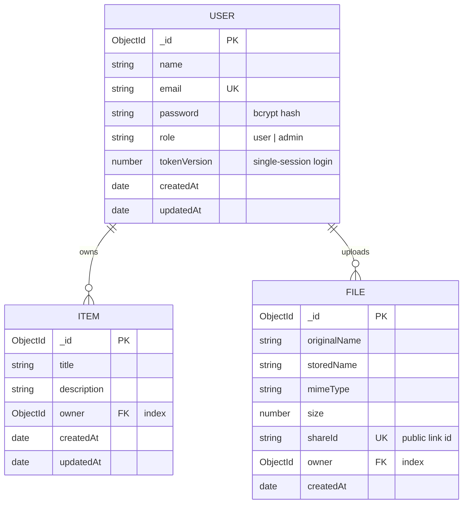
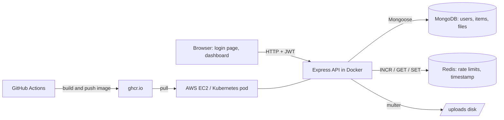

# MongoDB database design (system diagram)

## System diagram

## Design decisions
- **References, not embedding**: items and files point to their owner with an `owner` ObjectId. They grow without bound, so embedding them in the user document would not scale.
- **Indexes**: unique on `User.email` and `File.shareId`; secondary on `Item.owner` and `File.owner` for per-user queries.
- **Auth fields on User**: `role` for RBAC and `tokenVersion` for single-session login.
- **Passwords** are stored only as bcrypt hashes.
